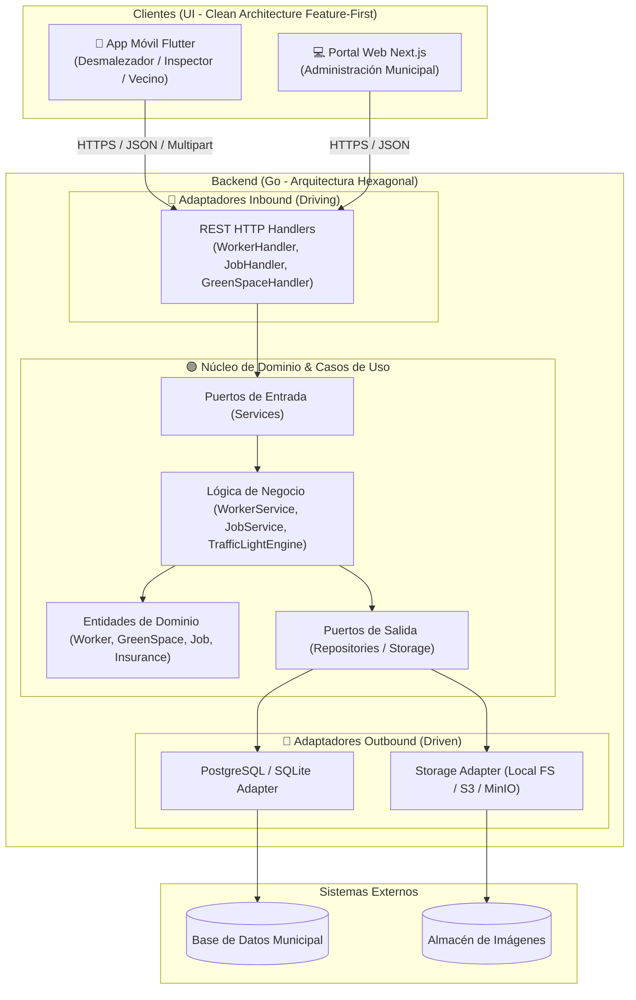
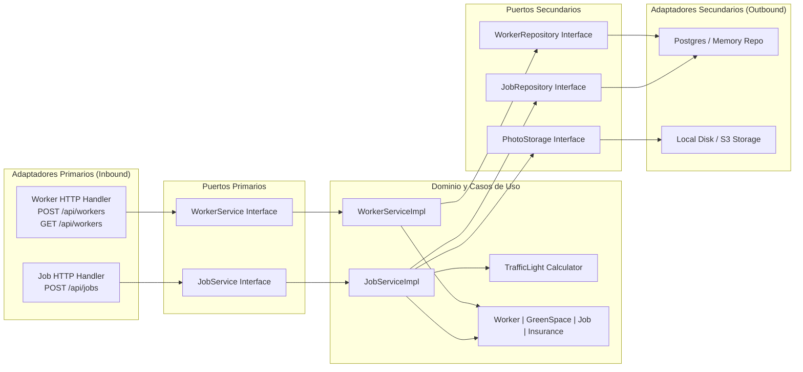
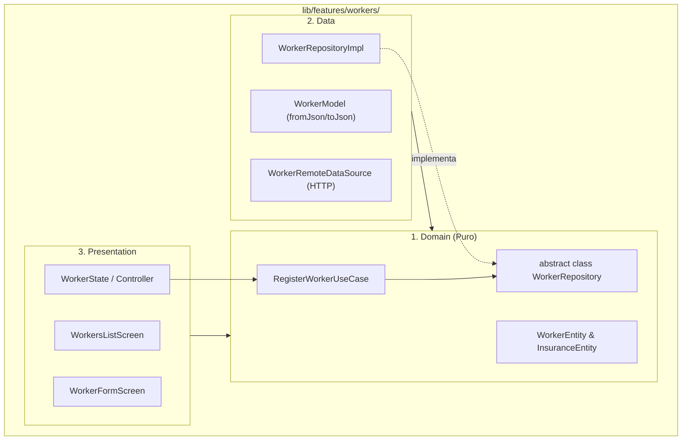

# Documento de Arquitectura y Diseño del Sistema
## Sistema de Gestión y Control de Desmalezado Municipal (Río Cuarto)

---

## 1. Visión General de la Arquitectura
El sistema adopta una arquitectura desacoplada de tipo **Monorepo Modular**:
- **Backend**: API REST en **Golang** con **Arquitectura Hexagonal (Ports & Adapters)**.
- **App Móvil**: **Flutter** con **Clean Architecture orientada a Features (Feature-First)** para trabajadores de campo, inspectores y vecinos.
- **Portal Web**: **Next.js 16 (App Router + TailwindCSS)** con enfoque **Feature-First** para la administración municipal y supervisión de semáforos.

---

## 2. Diagrama de Contenedores y Flujo del Sistema



---

## 3. Arquitectura Hexagonal del Backend (Go)



### Reglas clave en el Backend:
1. **El Dominio no conoce la base de datos ni HTTP**: `internal/core/domain` no importa librerías externas de base de datos ni `net/http`.
2. **Dependencias apuntan hacia adentro**: Los adaptadores dependen de las interfaces de `ports`, nunca al revés.
3. **Facilidad de Mocking y Testing**: Como los servicios dependen de interfaces (`ports.WorkerRepository`), se pueden testear unitariamente en milisegundos sin levantar una base de datos real.

---

## 4. Clean Architecture Feature-First en la UI (Flutter y Next.js)

Para que varios desarrolladores trabajen simultáneamente sin pisarse, organizamos el código por **Feature** y no por capa técnica:



### Módulos autónomos definidos:
| Módulo / Feature | Responsabilidad | Desarrollador sugerido |
| :--- | :--- | :--- |
| `features/auth/` | Login, selección de rol, almacenamiento de token. | Dev 1 |
| `features/workers/` | Registro de desmalezadores, consulta de nómina, control de pólizas (HU-001, HU-002). | Dev 2 |
| `features/traffic_light/` | Semáforo municipal (Verde/Amarillo/Rojo), cálculo de días y mapa de espacios verdes. | Dev 3 |
| `features/tasks/` | Ejecución de tareas: toma de fotografías antes/después y geoposicionamiento GPS. | Dev 4 |
| `features/inspections/` | Revisión, validación o rechazo de trabajos por el inspector municipal. | Dev 1 o 2 (Sprint 3) |

---

## 5. Lógica del Semáforo Municipal (RF-08, RF-14)
El estado de cada espacio verde se actualiza dinámicamente según el tipo de área y la fecha del último trabajo validado:

```text
Plazas:
  - 0 a 7 días:    🟢 VERDE (Óptimo)
  - 8 a 12 días:   🟡 AMARILLO (Alerta - próximo a mantenimiento)
  - > 12 días:     🔴 ROJO (Urgente - desmalezado atrasado)

Veredas y Ochavas:
  - 0 a 20 días:   🟢 VERDE (Óptimo)
  - 21 a 30 días:  🟡 AMARILLO (Alerta)
  - > 30 días:     🔴 ROJO (Urgente)
```
