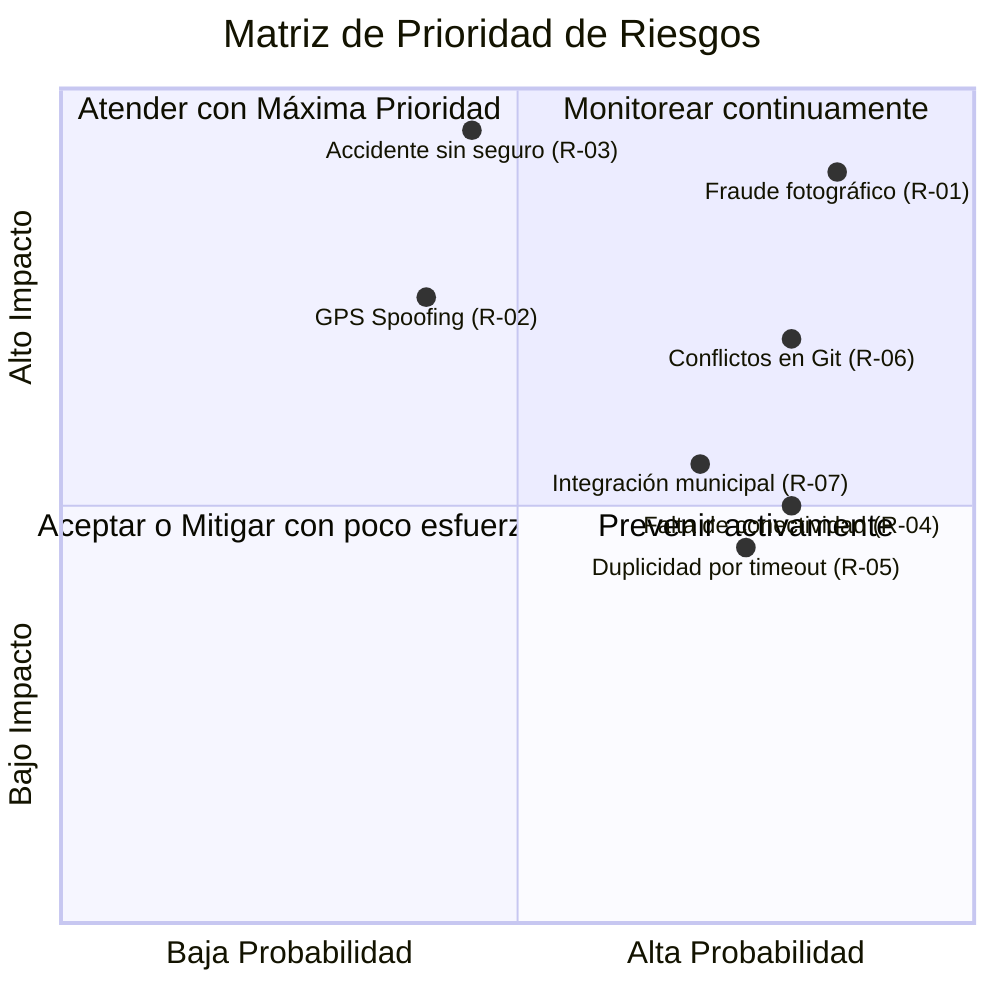

# Auditoría y Análisis de Riesgos del Proyecto
## Sistema de Gestión y Control de Desmalezado Municipal

> **Contexto del Trabajo:** En conformidad con el punto 1 del relevamiento municipal (Auditoría: Análisis de riesgos con IA), a continuación se presenta la identificación de riesgos generada por Inteligencia Artificial y la plantilla para la comparación con el análisis manual del equipo.

---

## 🤖 Parte A: Análisis de Riesgos Identificados por IA

| # | Riesgo | Categoría | Probabilidad | Impacto | Estrategia de Mitigación |
| :- | :--- | :--- | :---: | :---: | :--- |
| **R-01** | **Reutilización y fraude de fotografías de evidencia** Desmalezadores que suben fotos anteriores o descargadas de internet para cobrar sin trabajar. | Operativo / Confiabilidad | **Alta** | **Crítico** | 1. Hash SHA-256 de las imágenes para detectar duplicados exactos. 2. Extracción de metadatos EXIF (fecha/hora y coordenadas nativas de la foto). 3. Obligatoriedad de captura en tiempo real desde la cámara (bloqueando subida desde galería si es necesario). |
| **R-02** | **Falsificación de ubicación GPS (Spoofing)** Uso de aplicaciones de falsificación de GPS para registrar tareas fuera del lugar de trabajo. | Técnico / Seguridad | **Media** | **Alto** | 1. Validar distancia euclidiana entre las coordenadas GPS del reporte y el polígono o punto central de la plaza/vereda. 2. En Android, consultar flag del sistema `isFromMockProvider` para descartar ubicaciones simuladas. |
| **R-03** | **Trabajadores sin seguro vigente en el lugar de trabajo** Un operario sufre un accidente en la vía pública mientras su póliza municipal de accidentes personales estaba vencida. | Legal / Laboral | **Media** | **Crítico** | 1. Bloqueo automático por sistema: el backend no permite asignar tareas ni validar trabajos si `insurance.expires_at < now()`. 2. Alertas visuales con 7 y 3 días de antelación al administrador. |
| **R-04** | **Falta de conectividad móvil en campo (Zonas de baja señal)** Los desmalezadores en veredas u ochavas periféricas no disponen de 4G/5G y pierden los reportes. | Técnico / Usabilidad | **Alta** | **Medio** | 1. Modo *Offline-First* con almacenamiento local (SQLite/Hive) en Flutter. 2. Cola de sincronización en background (`sync queue`) que reintenta la subida cuando retorna la señal. |
| **R-05** | **Duplicidad de registros por reintentos de red** Ante timeout o red inestable, se reenvía el formulario creando 2 trabajos idénticos. | Confiabilidad (RNF) | **Alta** | **Medio** | 1. Implementación de claves de idempotencia (`Idempotency-Key` UUID) en el endpoint POST del backend Go. 2. El backend ignora peticiones duplicadas con el mismo UUID en un lapso de 10 minutos. |
| **R-06** | **Desalineación del equipo y cuellos de botella en Git (1 mes de plazo)** Conflicto de merges constantes si todos tocan los mismos archivos de routing o servicios. | Gestión / SCM | **Alta** | **Alto** | 1. Adopción estricta de Clean Architecture Feature-First: cada dev trabaja en su submódulo (`features/`). 2. Ramas cortas (`feature/HU-xxx`) con PRs de menos de 300 líneas y merges frecuentes a `main`. |
| **R-07** | **Incertidumbre en la integración con sistemas municipales existentes** El municipio menciona un portal web actual (`servicios.gobiernoriocuarto.gob.ar`) sin API clara documentada. | Arquitectura / Integración | **Alta** | **Medio** | 1. En el backend Go, diseñar puertos secundarios abstractos para la fuente de datos. 2. Iniciar con base de datos propia de la plataforma; si se habilita la API municipal, solo se escribe un nuevo adaptador sin tocar el dominio. |

---

## 👥 Parte B: Plantilla para el Análisis Manual del Equipo

*(Para ser completado por los integrantes del equipo durante la reunión de planificación)*

| # | Riesgo Identificado por el Equipo | Categoría | Probabilidad | Impacto | Mitigación Propuesta |
| :- | :--- | :--- | :---: | :---: | :--- |
| **RM-01** | *(ej. Curva de aprendizaje en Go o Flutter)* | Técnico | | | |
| **RM-02** | *(ej. Disponibilidad de tiempo de los integrantes por exámenes)* | Gestión | | | |
| **RM-03** | *(ej. Definición ambigua de 'plazo de 10 días' mencionada en PDF)* | Requerimientos | | | |

---

## ⚖️ Parte C: Comparativa y Conclusiones (Matriz de Riesgo)

