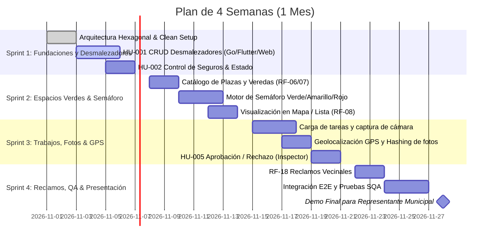

# Roadmap de Desarrollo (Plan de 1 Mes / 4 Sprints)
## Sistema de Gestión y Control de Desmalezado Municipal

Dado el plazo estricto de **1 mes**, el proyecto se organiza en **4 Sprints semanales**, asegurando entregables funcionales incrementales al cierre de cada semana.

---

## 🗓️ Cronograma General

---

## 📌 Detalle de Sprints e Hitos

### 🚀 Sprint 1: Arquitectura Base y Gestión de Desmalezadores (Semana 1)
- **Hito 1 (M1)**: Estructuras base funcionando (Go Hexagonal, Flutter Feature-First, Next.js).
- **Entregables funcionales**:
  - `HU-001`: Registro de nuevos desmalezadores con validación de DNI único.
  - `HU-002`: Carga de seguro de accidentes personales, cálculo automático de habilitación (`HABILITADO` vs `PENDIENTE_HABILITACION`).
  - Tabla de trabajadores en Web y lista interactiva en Flutter.
- **DoD del Sprint**: Tests unitarios de servicios en Go pasando, endpoints testeados en Postman/cURL, PRs aprobados.

### 🚦 Sprint 2: Espacios Verdes y Motor de Semáforo (Semana 2)
- **Hito 2 (M2)**: Mapa municipal con lógica semafórica en tiempo real.
- **Entregables funcionales**:
  - Catálogo de plazas, veredas y ochavas clasificadas por barrio (RF-06, RF-07).
  - Cálculo automático de días desde el último mantenimiento (RF-14).
  - Componente de semáforo (Verde / Amarillo / Rojo) en App Móvil y Dashboard Web.

### 📸 Sprint 3: Ejecución de Trabajos, Evidencias Fotográficas e Inspecciones (Semana 3)
- **Hito 3 (M3)**: Flujo completo de campo (Desmalezador registra &rarr; Inspector valida).
- **Entregables funcionales**:
  - `HU-004`: App móvil permite tomar fotos del trabajo y registra coordenadas GPS (RF-09, RF-11, RF-12).
  - Detección de fotos duplicadas por hash (RF-11 / Mitigación de fraude).
  - `HU-005`: Pantalla del inspector para aprobar o rechazar trabajos con observaciones (RF-13).
  - La aprobación del trabajo reinicia el semáforo del espacio verde a Verde (RF-15).

### 🏆 Sprint 4: Reclamos Vecinales, Auditoría SQA y Cierre (Semana 4)
- **Hito 4 (M4)**: Plataforma integral lista para producción/presentación.
- **Entregables funcionales**:
  - `HU-006` (RF-18): Módulo de consulta ciudadana y reclamos vecinales.
  - Estadísticas básicas para administración municipal (RF-16, RF-17).
  - Auditoría de código, corrección de bugs y smoke tests en dispositivos reales.
  - Preparación de presentación y reporte de riesgos contrastado con el cliente.
